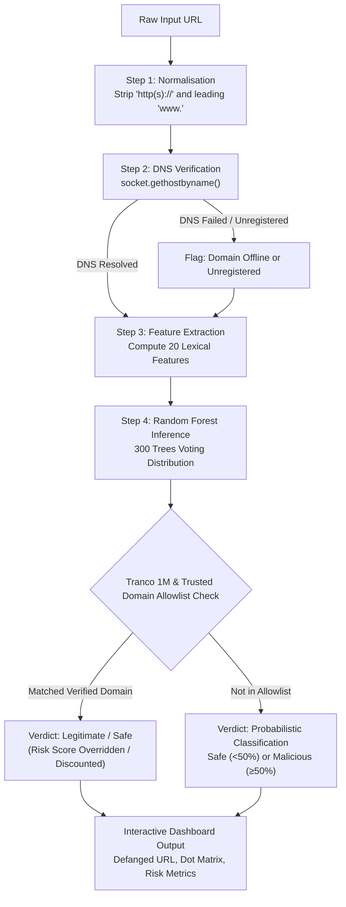

# 🛡️ Intelligent Phishing & Malicious URL Classifier

[](https://www.python.org/)
[](https://streamlit.io/)
[](https://scikit-learn.org/)
[](#benchmark-performance)
[](https://tranco-list.eu/)
[](LICENSE)

An intelligent, hybrid cyber-defense system that detects phishing and malicious URLs in real time. Powered by an ensemble of **300 Decision Trees (Random Forest)** trained on **450,176 labeled URLs**, coupled with **real-time DNS verification** and the **Tranco Top 1M reputation allowlist**.

---

## 📌 Table of Contents

- [Overview & Motivation](#-overview--motivation)
- [System Architecture](#-system-architecture)
- [Feature Engineering (20 Lexical Features)](#-feature-engineering-20-lexical-features)
- [Benchmark Performance](#-benchmark-performance)
- [Honest Testing & Data Leakage Prevention](#-honest-testing--data-leakage-prevention)
- [Dashboard Walkthrough](#-dashboard-walkthrough)
- [Project Structure](#-project-structure)
- [Local Installation & Quickstart](#-local-installation--quickstart)
- [Deployment Guide (Streamlit Community Cloud)](#-deployment-guide-streamlit-community-cloud)
  - [Fixing the `dashboard/requirements.txt` Deployment Error](#fixing-the-dashboardrequirementstxt-deployment-error)
  - [Configuring Model Weights via Streamlit Secrets](#configuring-model-weights-via-streamlit-secrets)
- [Model Training & Retraining](#-model-training--retraining)
- [Limitations & Future Roadmap](#-limitations--future-roadmap)
- [Contributing & License](#-contributing--license)

---

## 🚀 Overview & Motivation

Phishing remains the **#1 initial attack vector for enterprise security breaches** for the fourth consecutive year (*IBM Cost of a Data Breach Report 2026*, average breach cost: **\$5.29M**; over **3.8M phishing attacks** recorded by the APWG).

### Why Traditional Blocklists Fall Short

1. **Inherently Reactive**: A domain or URL must first claim victims and be reported before appearing on blocklists. Zero-day phishing campaigns slip through untouched.
2. **Ephemeral Infrastructure**: Attackers use fast-flux DNS, automated domain generation algorithms (DGAs), and free subdomains, switching addresses faster than blocklists can refresh.
3. **Blind to Unseen Targets**: Static lists cannot evaluate novel or modified URL permutations.

### The Hybrid Solution

This system uses a **Defense-in-Depth Hybrid Architecture**:
- **Proactive Lexical Inspection**: Analyzes 20 statistical, structural, and semantic properties of the URL address itself, without risking dangerous page downloads or malware execution.
- **DNS Resolution Check**: Pre-filters unreachable, unregistered, or offline fake domains before running compute-heavy routines.
- **Reputation Filtering**: Matches the target against the **Tranco Top 1 Million** most visited legitimate domains and trusted institutional TLDs (`.edu.in`, `.gov.in`, `.ac.in`), minimizing false alarms on high-traffic sites.
- **Explainable Ensemble Predictions**: Displays individual voting behavior across all 300 decision trees alongside feature importance rankings.

---

## 🏗️ System Architecture



---

## 🔍 Feature Engineering (20 Lexical Features)

The classification pipeline extracts 20 handcrafted lexical, structural, and contextual features directly from the normalized URL:

| # | Feature Name | Description | Threat Indicator / Rationale |
|---|---|---|---|
| 1 | `url_length` | Total character length of normalized URL | Phishing URLs are frequently elongated to obfuscate the real target. |
| 2 | `hostname_length` | Length of the domain name | Attackers register long typosquatted or keyword-stuffed hostnames. |
| 3 | `path_length` | Character length of the URL path | Deep, complex paths often hide malicious scripts or redirection chains. |
| 4 | `query_length` | Character length of query string | Heavy parameter strings can carry encoded phishing payloads or tokens. |
| 5 | `num_dots` | Count of `.` characters | Excessive dots signal nested subdomains (e.g. `paypal.com.account-verify.xyz`). |
| 6 | `num_hyphens` | Count of `-` characters | Hyphens are widely used to mimic brand names (e.g. `apple-login-security`). |
| 7 | `num_underscores` | Count of `_` characters | Uncommon in legitimate hostnames; often used in obfuscated endpoints. |
| 8 | `num_digits` | Total numeric characters | Random hash strings or server identifiers common in malware drops. |
| 9 | `digit_ratio` | Ratio of digits to total URL length | Measures disproportionate numeric concentration. |
| 10 | `has_at` | Boolean flag for `@` symbol | In URL standards, text before `@` is treated as userinfo, obscuring real host. |
| 11 | `is_ip` | Boolean flag for bare IPv4 address | Legitimate public brands use domain names; raw IPs indicate ad-hoc C2s. |
| 12 | `path_depth` | Count of `/` directory slashes | Measures folder nesting depth. |
| 13 | `num_subdomains` | Count of subdomains extracted via `tldextract` | Accurately identifies multi-level subdomains without tripping on `.co.uk` or `.edu.in`. |
| 14 | `num_params` | Count of `&` separated query arguments | Number of arguments passed to server. |
| 15 | `suspicious_words` | Presence of high-risk keywords (`login`, `verify`, `secure`, `bank`, `update`, etc.) | Social engineering lures designed to provoke urgent user credential input. |
| 16 | `entropy` | Shannon Entropy of character distribution | Detects randomized strings, algorithmic domain generation (DGA), or hex encoding. |
| 17 | `has_double_slash_in_path` | Presence of `//` inside URL path | Open redirect trick used to forward users from a benign site to a malicious host. |
| 18 | `tld_length` | Length of top-level domain suffix | Adjusted for compound suffixes like `.edu.in` and `.gov.in`. |
| 19 | `num_special_chars` | Count of non-alphanumeric characters | High density of symbols indicates obfuscation. |
| 20 | `is_safe_tld` | Flag for trusted government/educational TLDs | Protects `.gov.in`, `.nic.in`, `.edu.in`, `.ac.in`, `.gov`, `.edu`. |

---

## 📊 Benchmark Performance

The Random Forest model was evaluated on an **untouched test split of 90,036 URLs** (stratified from 450,176 total samples in `urldata.csv`):

| Metric | Score | Details |
|---|---|---|
| **Test Accuracy** | **92.76%** | High overall fidelity across balanced test partition |
| **Precision** | **83.31%** | Minimizes false accusations of benign infrastructure |
| **Recall** | **86.03%** | Captures 86+ out of every 100 malicious/phishing links |
| **F1-Score** | **84.64%** | Harmonic mean reflecting balanced robustness |
| **Tranco False Alarm Rate** | **1.2%** | Tested against 2,000 completely unseen Tranco Top-1M domains |
| **Indian `.in` False Alarm Rate** | **0.6%** | Evaluated specifically on Indian institutional & commercial domains |

### Confusion Matrix (90,036 Unseen URLs)

```text
                       Predicted Benign    Predicted Malicious
Actual Benign (Safe)       65,554                 3,594
Actual Malicious            2,946                17,942
```

---

## 🔬 Honest Testing & Data Leakage Prevention

> [!IMPORTANT]
> In raw datasets, many benign URLs begin with `https://www.` while older malicious URL dumps often start with plain `http://`. A naive machine learning model will easily achieve **99.7% training accuracy** simply by memorizing whether `https` or `www` is present.

To prevent this data leakage:
1. **Mandatory Normalization**: Both `normalize(url)` during training and inference strip the protocol scheme (`http://`, `https://`) and any leading `www.` prefix.
2. **Domain Holdout**: 10% of popular Tranco domains and sensitive enterprise/institutional probe domains (e.g. `google.com`, `amazon.in`, `iitd.ac.in`, `flipkart.com`, `isro.gov.in`) were **strictly excluded from training** to serve as an authentic benchmark for real-world false alarm rates.

---

## 🖥️ Dashboard Walkthrough

The project features a **Streamlit dark cyber-themed dashboard**:

- **Real-Time Link Inspection**: Input any link to see a step-by-step radar animation verifying DNS status, feature extraction, and ML scoring.
- **Defanged URL Sharing**: Automatically generates safe, unclickable representations (e.g. `hxxps[://]badsite[.]com/login`) for SOC ticket logging without accidental clicks.
- **Domain Anatomy Breakdown**: Visualizes the registered domain, subdomain hierarchy, and institutional trust badges.
- **Tree Ensemble Voting Matrix**: A 300-dot matrix showing the exact proportion of trees that voted benign (green) vs malicious (red).
- **Batch CSV / Multiline Scanner**: Upload a `.csv` or paste up to 50 URLs at once, inspect live progress, and export the complete threat audit as a downloadable CSV.

---

## 📁 Project Structure

```text
Intelligent Phishing & Malicious URL Classifier/
├── app.py                     # Root entrypoint wrapper (Streamlit Community Cloud compatible)
├── requirements.txt           # Primary dependencies at repository root
├── train.py                   # Standalone training & evaluation pipeline script
├── urldata.csv                # Primary labeled dataset (450,176 URLs)
├── README.md                  # Comprehensive project documentation
├── .gitignore                 # Excludes caches, virtualenvs, and large model binaries (>100MB)
├── dashboard/                 # Streamlit Web Application directory (no spaces)
│   ├── app.py                 # Core Streamlit application & interactive UI
│   ├── features.py            # 20-feature extraction engine & normalization
│   ├── requirements.txt       # Subdirectory requirements mirroring root
│   ├── metrics.json           # Model evaluation benchmarks
│   ├── top-1m.csv             # Local Tranco 1M reputation allowlist dataset
│   ├── trusted_domains.txt    # Custom domain overrides and institutional whitelists
│   ├── phishing_model.pkl     # Compressed trained Random Forest model (generated)
│   └── .streamlit/
│       └── config.toml        # Streamlit cyber dark-theme styling configuration
└── archive/
    └── phishing_url_dataset_unique.csv  # Supplementary archive dataset
```

---

## 💻 Local Installation & Quickstart

### Prerequisites
- Python 3.10, 3.11, 3.12, 3.13, or 3.14
- Git

### 1. Clone the Repository
```bash
git clone https://github.com/lavaychoudhary/intelligent-phishing-url-classifier.git
cd intelligent-phishing-url-classifier
```

### 2. Create and Activate a Virtual Environment
```bash
# Windows
python -m venv venv
venv\Scripts\activate

# macOS / Linux
python3 -m venv venv
source venv/bin/activate
```

### 3. Install Dependencies
```bash
pip install -r requirements.txt
```

### 4. Run the Streamlit Dashboard
```bash
# Option A: Run directly from root
streamlit run app.py

# Option B: Run from the dashboard directory
streamlit run dashboard/app.py
```
Open your browser at `http://localhost:8501`.

---

## ☁️ Deployment Guide (Streamlit Community Cloud)

### Fixing the `dashboard/requirements.txt` Deployment Error

#### Root Cause
If your application folder is named with a space (e.g., `Streamlit dashboard`), the cloud build runner executes:
```bash
uv pip install -r Streamlit dashboard/requirements.txt
```
Because the path variable is unquoted in the container shell script, bash splits arguments on the space:
- `-r Streamlit` (fails to find file `Streamlit`)
- `dashboard/requirements.txt` (passed as an extra positional package argument)

`uv` throws:
```text
error: Failed to parse: dashboard/requirements.txt
cause: Expected path (dashboard/requirements.txt) to end in a supported file extension: .whl, .tar.gz...
```
And standard `pip` throws:
```text
ERROR: Invalid requirement: 'dashboard/requirements.txt': Expected semicolon or end
Hint: It looks like a path. File 'dashboard/requirements.txt' does not exist.
```

#### How This Repository Resolves It
1. The folder has been renamed to `dashboard/` (no whitespace).
2. `requirements.txt` is maintained at both the **repository root** and inside `dashboard/`.
3. A root `app.py` wrapper is provided so Streamlit Community Cloud can deploy with zero configuration.

#### Streamlit Cloud Deployment Settings
- **Repository**: `your-username/intelligent-phishing-url-classifier`
- **Branch**: `main`
- **Main file path**: `app.py` (or `dashboard/app.py`)

---

### Configuring Model Weights via Streamlit Secrets

> [!NOTE]
> Trained scikit-learn Random Forest models with 300 deep trees are ~250 MB uncompressed and ~70–220 MB compressed. GitHub rejects any direct file upload over **100 MB**.

`dashboard/app.py` includes built-in support for downloading model weights automatically from a remote URL.

1. Upload your `phishing_model.pkl` to:
   - **GitHub Releases** (Free, supports files up to 2 GB per asset with fast direct CDN links)
   - **Hugging Face Hub**
   - **Google Drive** or **AWS S3**
2. In your Streamlit Community Cloud app dashboard, click **Settings → Secrets**.
3. Add your download URL:
```toml
MODEL_URL = "https://github.com/your-username/intelligent-phishing-url-classifier/releases/download/v1.0.0/phishing_model.pkl"
```
When your app boots, it will automatically download `phishing_model.pkl` into the `dashboard/` directory and cache it.

---

## ⚙️ Model Training & Retraining

You can retrain the model locally using `train.py`:

```bash
# Full training run on all 450,176 URLs with Tranco augmentation:
python train.py

# Fast test run using a sample of 25,000 URLs:
SAMPLE=25000 python train.py
```

The script will:
1. Load `urldata.csv` and deduplicate records.
2. Augment benign domains from the local Tranco Top 1M list (`dashboard/top-1m.csv`).
3. Extract all 20 lexical features.
4. Fit a `RandomForestClassifier(n_estimators=300, min_samples_leaf=2, class_weight='balanced')`.
5. Output accuracy, precision, recall, confusion matrix, and feature importances.
6. Export the compressed model to `dashboard/phishing_model.pkl` and benchmark scores to `dashboard/metrics.json`.

---

## 🔮 Limitations & Future Roadmap

- **Content-Agnostic Limitation**: The classifier operates purely at the URL lexical layer. If an attacker hosts a credential harvest page on an uncompromised, trusted root domain (e.g. `docs.google.com/forms/...`), lexical features alone may score the root domain as benign.
- **Shortened URLs**: Bit.ly or tinyurl redirects conceal destination lexical properties. Future versions will integrate safe HTTP HEAD redirection expansion.
- **Model Distillation**: Training an XGBoost or LightGBM model with tree pruning to reduce the serialized artifact footprint under 50 MB for direct git tracking.

---

## 📜 Contributing & License

Contributions, bug reports, and pull requests are welcome! Feel free to open an issue.

Distributed under the MIT License. See `LICENSE` for details.
